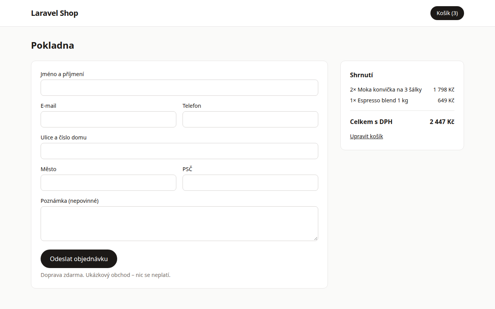
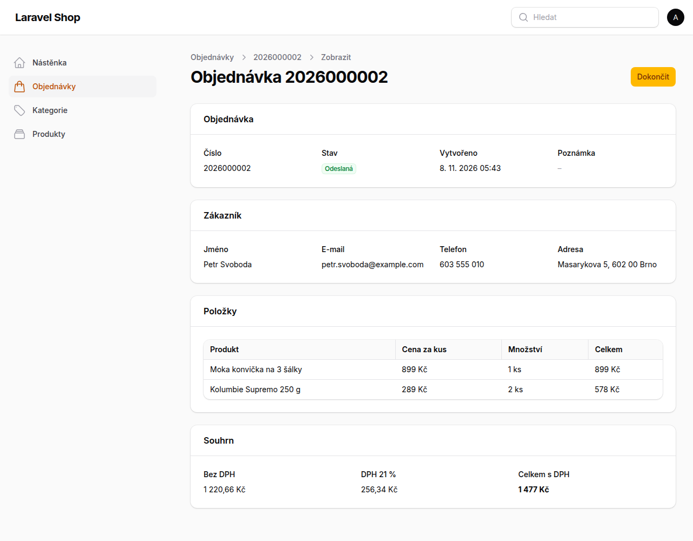
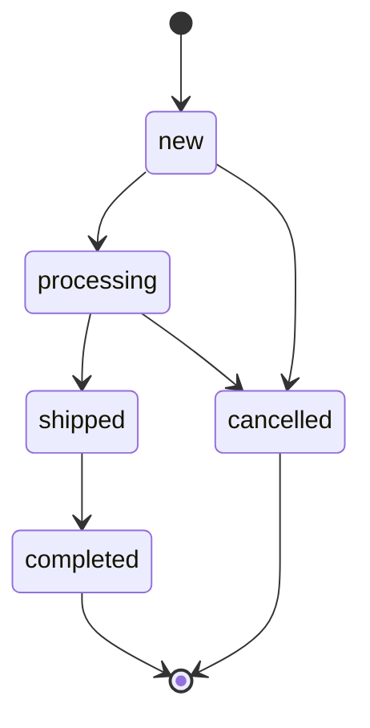

# Laravel Shop

A small coffee & tea shop built with Laravel 13, Livewire 4 and Filament 5. Guests browse a
catalogue, fill a session cart and place an order without registering; the shop owner manages
the catalogue and moves orders through their states in an admin panel. It is a portfolio
project: the scope is deliberately small, the e-commerce details are not – money in integer
hellers, VAT from the order total, price snapshots, a stock lock measured under real
concurrency, and order states guarded in one place.

The storefront and the admin are in Czech; code, comments and docs are in English.


| Checkout | Admin – orders | Admin – order detail |
|---|---|---|
|  |  |  |

## Features

- **Catalogue** – categories, product listing and detail; sold-out products stay visible, unavailable ones return 404.
- **Session cart** (Livewire) – add, change quantity, remove; quantities are validated against stock and a per-line limit.
- **Guest checkout** – name, e-mail, phone, address, note; free delivery, no payment.
- **Order confirmation** – a signed URL, so order numbers cannot be enumerated to read other people's addresses.
- **Confirmation e-mail** – a queued Mailable, dispatched only after the order transaction commits.
- **Admin** (Filament, `/admin`) – categories and products (CRUD), orders (list with status filter, detail with VAT breakdown, status changes as actions – orders are never edited freely).
- **Demo data** – 3 categories, 12 products with bundled images and 6 orders in every state, all placed through the real checkout so stock adds up.

## Domain decisions

**Money is an integer number of hellers** (1 Kč = 100 hellers) everywhere – database, PHP, tests.
Prices are entered with VAT; the admin form takes crowns (`1299,50`) and converts the string
without ever going through a float.

**VAT is computed from the order total**, not per line, with a single shop-wide rate (21 %, in
`config/shop.php`): `vat = total × rate / (100 + rate)`, rounded half up to whole hellers, in
integer arithmetic. The rate is stored on the order, so changing it never changes old orders.

**Orders keep a snapshot** – each item stores the product name, unit price and line total at
the time of purchase. Renaming, repricing or deleting a product does not change past orders.

**The cart can go stale.** The cart remembers the price the customer saw. If the price,
availability or stock changes before the order is submitted, no order is created: the cart is
refreshed to current values and the customer sees exactly what changed before submitting again.

**Stock is taken under a row lock.** Checkout locks the products (`lockForUpdate`, always in id
order, so overlapping carts cannot deadlock) and checks stock inside the transaction. Verified
with `composer race`: ten processes buy the last piece at the same moment → exactly one order,
stock 0, and nine customers get the "cart changed" message. Without the lock the unsigned
`stock` column still prevents overselling, but the nine losers get a database error instead
of a clear message – the lock is what turns a collision into a clean refusal.

**Order states** are an enum with an explicit transition matrix; `TransitionOrder` is the only
place that changes a status. It re-reads the order under a lock, so two admins cancelling the
same order at once cannot return the stock twice. Cancelling returns the goods to stock.



Order numbers are readable (`2026000123` = year + sequence).

## Tech stack

Laravel 13 · PHP 8.4 · MySQL 8 · Livewire 4 · Filament 5 · Tailwind CSS 4 + Vite ·
Laravel Sail (Docker) · Mailpit · Pest 4 (+ browser and mutation plugins) · Larastan (level 6) · Pint

## Quick start

Requires Docker. Nothing else is needed on the host – Composer runs in a container.

```bash
git clone <repository-url> laravel-shop && cd laravel-shop
cp .env.example .env

docker run --rm -u "$(id -u):$(id -g)" -v "$PWD":/app -w /app composer:2.10 \
    composer install --ignore-platform-reqs

./vendor/bin/sail up -d
./vendor/bin/sail artisan key:generate
./vendor/bin/sail artisan migrate --seed
./vendor/bin/sail npm ci
./vendor/bin/sail npm run build
```

If `migrate` reports that it cannot connect, MySQL is still starting – run it again.

- Shop: <http://localhost:8088>
- Admin: <http://localhost:8088/admin> – `admin@example.com` / `password`
- Mailpit (sent e-mails): <http://localhost:8025> – confirmation e-mails are queued; run
  `./vendor/bin/sail artisan queue:work` to send them.

Ports are set in `.env` (`APP_PORT`, `FORWARD_DB_PORT`, …) if the defaults are taken.

## Quality checks

All commands run inside Sail (`./vendor/bin/sail composer <script>`):

| Script | What it does |
|---|---|
| `qa` | Pint (`--test`), Larastan, the Pest unit + feature suite in parallel |
| `race` | the stock race: 10 processes buy the last piece at once on a separate `shop_race` database; fails unless exactly one order is created (`scripts/race-check.sh 20` for more processes) |
| `mutate` | mutation testing of the checkout and order domain (`Cart`, `PlaceOrder`, `TransitionOrder`, `Vat`), minimum score 80 % |
| `test:browser` | Playwright tests of the purchase path and the admin status change (needs the built assets) |

The browser tests need Chromium once: `./vendor/bin/sail npx playwright install chromium --only-shell`.
It is stored in `./.playwright` (set `PLAYWRIGHT_BROWSERS_DIR` in `.env` to reuse an existing
Playwright cache).

## Out of scope

Product variants, discounts and coupons, payments, search, customer accounts, multiple
currencies, languages or VAT rates, priced shipping methods, invoices.

Known limitation: a second submit of the same checkout is handled (the cart is empty, the
customer is sent back with a message), but two truly simultaneous requests from one session
are not deduplicated by an idempotency key.

## License

[MIT](LICENSE)
