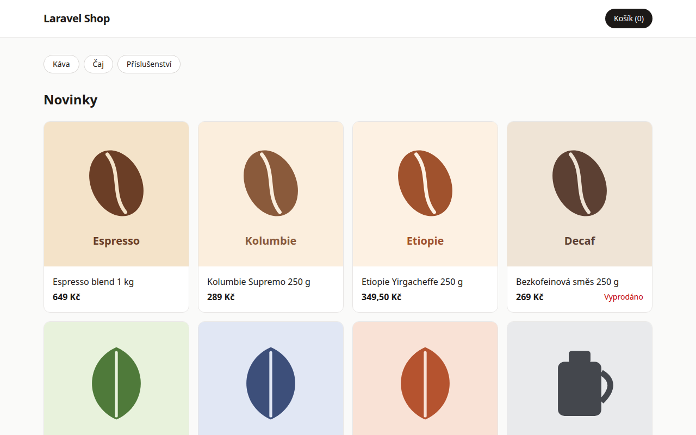
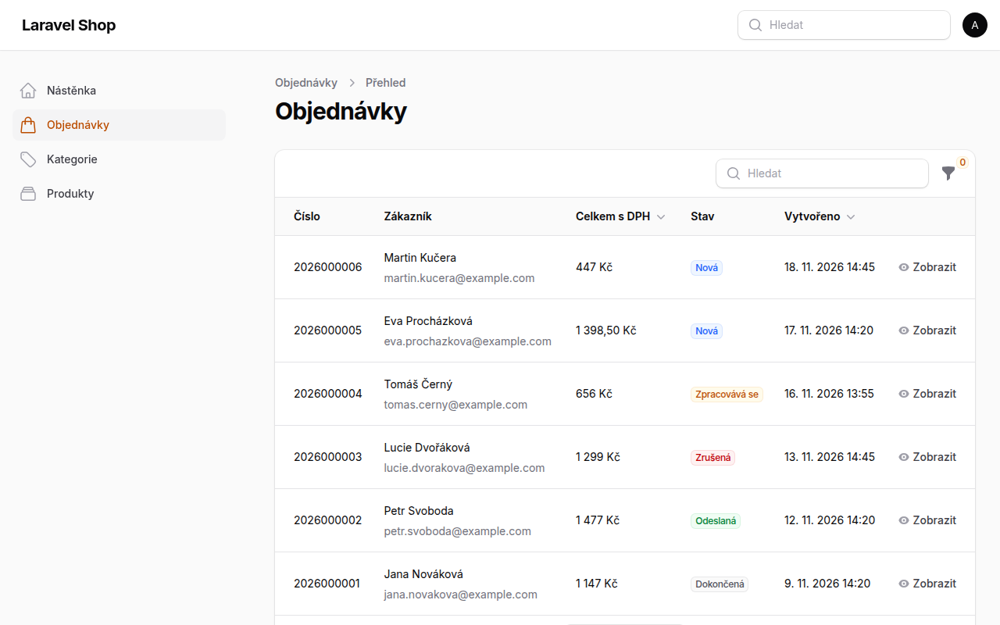
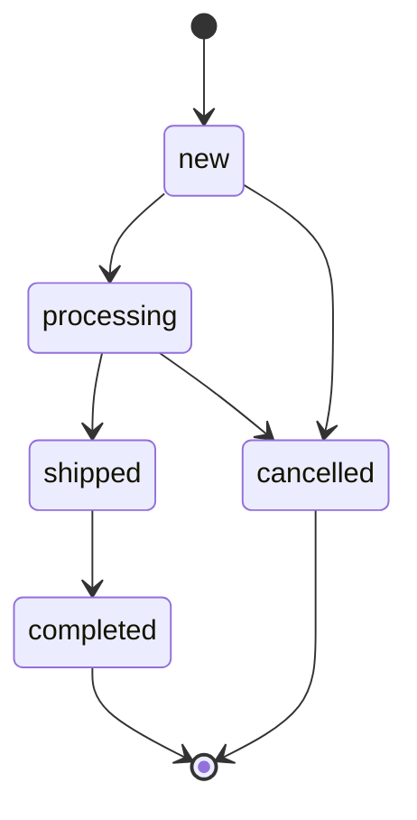

# Laravel Shop

[](https://github.com/jantydlacka/laravel-shop/actions/workflows/ci.yml)

A small coffee & tea shop built with Laravel 13, Livewire 4 and Filament 5. Guests browse a
catalogue, fill a session cart and place an order without registering; the shop owner manages
the catalogue and moves orders through their states in an admin panel. It is a portfolio
project: the scope is deliberately small, the e-commerce details are not – money in integer
hellers, VAT from the order total, price snapshots, a stock lock measured under real
concurrency, and order states guarded in one place.

The storefront and the admin are in Czech; code, comments and docs are in English.



| Checkout | Admin – orders | Admin – order detail |
|---|---|---|
|  |  |  |

## Features

- **Catalogue** – categories, product listing and detail; sold-out products stay visible, unavailable ones return 404.
- **Session cart** (Livewire) – add, change quantity, remove; quantities are validated against stock and a per-line limit.
- **Guest checkout** – name, e-mail, phone, address, note; free delivery, no payment.
- **Order confirmation** – a signed URL valid for an hour, so order numbers cannot be enumerated to read other people's addresses.
- **Confirmation e-mail** – a queued Mailable, dispatched only after the order transaction commits.
- **Admin** (Filament, `/admin`) – categories and products (CRUD), orders (list with status filter, detail with VAT breakdown, status changes as actions – orders are never edited freely).
- **JSON API** (`/api`) – catalogue, cart check and order placement for a separate client, sharing the domain logic with the web checkout (see [JSON API](#json-api)).
- **Demo data** – 3 categories, 12 products with bundled images and 6 orders that together cover every state, all placed through the real checkout so stock adds up.

## Domain decisions

**Money is an integer number of hellers** (1 Kč = 100 hellers) everywhere – database, PHP, tests.
Prices are entered with VAT; the admin form takes crowns (`1299,50`) and converts the string
without ever going through a float.

**VAT is computed from the order total**, not per line, with a single shop-wide rate (21 %, in
`config/shop.php`): `vat = total × rate / (100 + rate)`, rounded half up to whole hellers, in
integer arithmetic. The rate is stored on the order, so changing it never changes old orders.

**Orders keep a snapshot** – each item stores the product name, unit price and line total at
the time of purchase. Renaming, repricing or deleting a product does not change past orders.

**The cart can go stale.** The cart remembers the price the customer saw. If the price,
availability or stock changes before the order is submitted, no order is created: the cart is
refreshed to current values and the customer sees exactly what changed before submitting again.
The order is also refused when the cart differs from the summary the customer confirmed, for
example after a change in another tab.

**One cart, one order.** The cart carries a token that the order stores under a unique index, so
a double click or two parallel requests from the same session create a single order; the second
request rolls back without touching the stock. Orders from one IP
address are limited to 10 an hour (`config/shop.php`). Behind a reverse proxy, configure trusted
proxies, otherwise every customer shares the proxy's address and the limit applies to the whole shop.

**Stock is taken under a row lock.** Checkout locks the products (`lockForUpdate`, always in id
order, so overlapping carts cannot deadlock) and checks stock inside the transaction. Verified
with `composer race`: ten processes buy the last piece at the same moment → exactly one order,
stock 0, and nine customers get the "cart changed" message. Without the lock the unsigned
`stock` column still prevents overselling, but the nine losers get a database error instead
of a clear message – the lock is what turns a collision into a clean refusal.

**Order states** are an enum with an explicit transition matrix; `TransitionOrder` is the only
place that changes a status. It re-reads the order under a lock, so two admins cancelling the
same order at once cannot return the stock twice. Cancelling returns the goods to stock.

**The admin cannot overwrite stock it did not touch.** Saving a product writes the stock only
when the admin changed it, and only if it still holds the value the form loaded; if an order or
a cancellation moved it in the meantime, nothing is saved and the admin sees the current count.



Order numbers are readable (`2026000123` = year of the order + its id, which keeps counting across years). Dates and times are in Czech time (`Europe/Prague`).

## JSON API

A JSON API under `/api` lets a separate client ([shop-react](https://github.com/jantydlacka/shop-react), a React + TypeScript storefront) browse the catalogue and place
orders. It uses the same actions as the web checkout, so stock, prices, the quantity limit and the
hourly order limit behave identically. Prices are integers in hellers; the client does the formatting.
Error messages are in Czech.

| Method | Path | Purpose |
|---|---|---|
| `GET` | `/api/categories` | categories |
| `GET` | `/api/products` | paginated products (12 per page), see the parameters below |
| `GET` | `/api/products/{slug}` | product detail |
| `POST` | `/api/cart/check` | compares a client-side cart with current prices and stock |
| `POST` | `/api/orders` | places an order |

`GET /api/products` takes these optional query parameters:

| Parameter | Values | Default |
|---|---|---|
| `q` | up to 100 characters after trimming; substring of the name or description, `%` and `_` match literally; letter case and diacritics follow the database collation (`utf8mb4_unicode_ci`: `caj` finds `Čaj`) | no search |
| `sort` | `newest`, `name`, `price_asc`, `price_desc` (ties are broken by `id`) | `newest` |
| `in_stock` | `1` or `0`; only `stock > 0` with `1` (`true` and `false` are rejected) | `0` |
| `category` | category slug (404 when unknown) | all |
| `page` | integer 1–10 000 | `1` |

Invalid values return 422 (`message` and `errors`). The response is `data`, `links` and `meta`
(`current_page`, `last_page`, `per_page`, `total`, ...); a page past the last one has an empty `data`.
Behaviour change: a category is no longer ordered by name, the default order is `newest` everywhere,
and the listing without a category is no longer capped at 12 products but paginated.

`POST /api/orders` takes the cart token (a UUID generated by the client), the items with the price
the customer saw, and the customer. Responses never contain the customer's personal data.
In the example, take the product `id` and `price` from `GET /api/products`; the values below are placeholders.

```bash
curl -X POST http://localhost:8088/api/orders \
  -H 'Accept: application/json' -H 'Content-Type: application/json' \
  -d '{
    "cart_token": "6f1c1e0a-3b7d-4c43-9a55-0d6a4e2f9b10",
    "items": [{"product_id": 1, "quantity": 2, "price": 24900}],
    "customer": {
      "name": "Test Customer", "email": "test@example.com", "phone": "000000000",
      "street": "Test Street 1", "city": "Testville", "zip": "00000"
    }
  }'
```

| Status | Meaning |
|---|---|
| `201` | order created, body in the `data` envelope |
| `200` | the same token **and the same items** were already ordered – the existing order is returned |
| `409` | `{"code": "cart_changed", "messages": [...], "items": [...]}` (price, availability or stock changed) or `{"code": "cart_already_ordered", ...}` (the token already placed an order with different items; the message names that order and tells the customer to check the kept cart and send it again, which creates a new order) |
| `404` | catalogue endpoints only: unknown or unavailable product slug, or unknown category |
| `422` | validation errors |
| `429` | too many orders from this IP; `Retry-After` header |

## Known limitations

- **The hourly order limit is not atomic.** The check and the count are separate steps, so a burst
  of parallel requests can overshoot it. The web checkout has the same limit and the same behaviour.
- **Behind a reverse proxy, configure `trustProxies`.** Otherwise every customer shares the proxy's
  address and the limit applies to the whole shop.
- **CORS is the framework default** (any origin, no credentials). The React client goes through the Vite dev proxy; a deployment would need a published `config/cors.php` restricted to its one origin.

## Tech stack

Laravel 13 · PHP 8.4 · MySQL 8 · Livewire 4 · Filament 5 · Tailwind CSS 4 + Vite ·
Laravel Sail (Docker) · Mailpit · Pest 4 (with the browser plugin and built-in mutation testing) · Larastan (level 6) · Pint

## Quick start

Requires Docker. Nothing else is needed on the host – Composer runs in a container.

```bash
git clone <repository-url> laravel-shop && cd laravel-shop
cp .env.example .env

docker run --rm -u "$(id -u):$(id -g)" -v "$PWD":/app -w /app composer:2.10 \
    composer install --ignore-platform-reqs

./vendor/bin/sail up -d --wait
./vendor/bin/sail artisan key:generate
./vendor/bin/sail artisan storage:link
./vendor/bin/sail artisan migrate --seed
./vendor/bin/sail npm ci
./vendor/bin/sail npm run build
```

`--wait` matters on the first start: MySQL initialises its empty volume before it accepts
connections, and `migrate` would fail without it.

- Shop: <http://localhost:8088>
- Admin: <http://localhost:8088/admin> – `admin@example.com` / `password`
- Mailpit (sent e-mails): <http://localhost:8025> – confirmation e-mails are queued; run
  `./vendor/bin/sail artisan queue:work` to send them. The first six are the confirmations of
  the demo orders.

The demo admin is not created when `APP_ENV=production`.

Ports are set in `.env` (`APP_PORT`, `FORWARD_DB_PORT`, …) if the defaults are taken.

## Quality checks

All commands run inside Sail (`./vendor/bin/sail composer <script>`):

| Script | What it does |
|---|---|
| `qa` | Pint (`--test`), Larastan, the Pest unit + feature suite in parallel |
| `race` | the stock race: 10 processes buy the last piece at once on a separate `shop_race` database; fails unless exactly one order is created (`scripts/race-check.sh 20` for more processes) |
| `race:token` | the same cart token from 10 parallel processes (stock 5): exactly one order, stock 4, the other nine refused as already ordered |
| `mutate` | mutation testing of the checkout and order domain (`Cart`, `CartLine`, `PlaceOrder`, `TransitionOrder`, `OrderStatus`, `Vat`), minimum score 80 % |
| `test:browser` | Playwright tests of the purchase path and the admin status change (needs the built assets) |

The browser tests need Chromium once: `./vendor/bin/sail npx playwright install chromium --only-shell`.
It is stored in `./.playwright` (set `PLAYWRIGHT_BROWSERS_DIR` in `.env` to reuse an existing
Playwright cache).

## Out of scope

Product variants, discounts and coupons, payments, search, customer accounts, multiple
currencies, languages or VAT rates, priced shipping methods, invoices.

Security headers (CSP, HSTS, `X-Frame-Options`, …) are left to the web server in front of the
application.

## License

[MIT](LICENSE)
